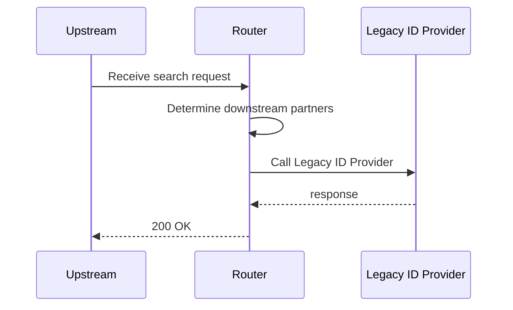

# no-partners

No SSN and no PNumber: no partner is called

**Status:** 200 (expected 200) · **Called:** Legacy ID Provider

## Expected behavior

- **Legacy ID provider lookup** is called once — The new ID provider is switched off, which is the default.
  - Last name is Ellis
- **New ID provider lookup** is not called.
- **Partner A match search** is not called — Partner A needs an SSN.
- **Partner B match search** is not called — Partner B needs a PNumber.
- **Partner C match search** is not called — Partner C needs an SSN.
- **The response:**
  - Person ID is LEGACY-ELLIS
  - Results has 0 entries

## Request

<details><summary>POST /search</summary>

```json
{
  "header" : {
    "requestId" : "no-partners",
    "source" : "flow-scenario",
    "timestamp" : "2026-10-20T12:00:00Z"
  },
  "documents" : [ ],
  "person" : {
    "first" : "Jo",
    "last" : "Ellis",
    "birthDate" : "2000-01-01"
  }
}
```

</details>

## Flow



## Downstream calls

### POST /legacy-id-provider/lookup → 200

Matched `stubs[0]`.

<details><summary>Request sent</summary>

```json
{
  "firstName" : "Jo",
  "lastName" : "Ellis",
  "birthDate" : "2000-01-01",
  "ssn" : null,
  "pNumber" : null
}
```

</details>

<details><summary>Response returned</summary>

```json
{
  "personId" : "LEGACY-ELLIS"
}
```

</details>

## Response

<details><summary>200 OK</summary>

```json
{
  "requestId" : "no-partners",
  "personId" : "LEGACY-ELLIS",
  "results" : [ ]
}
```

</details>
