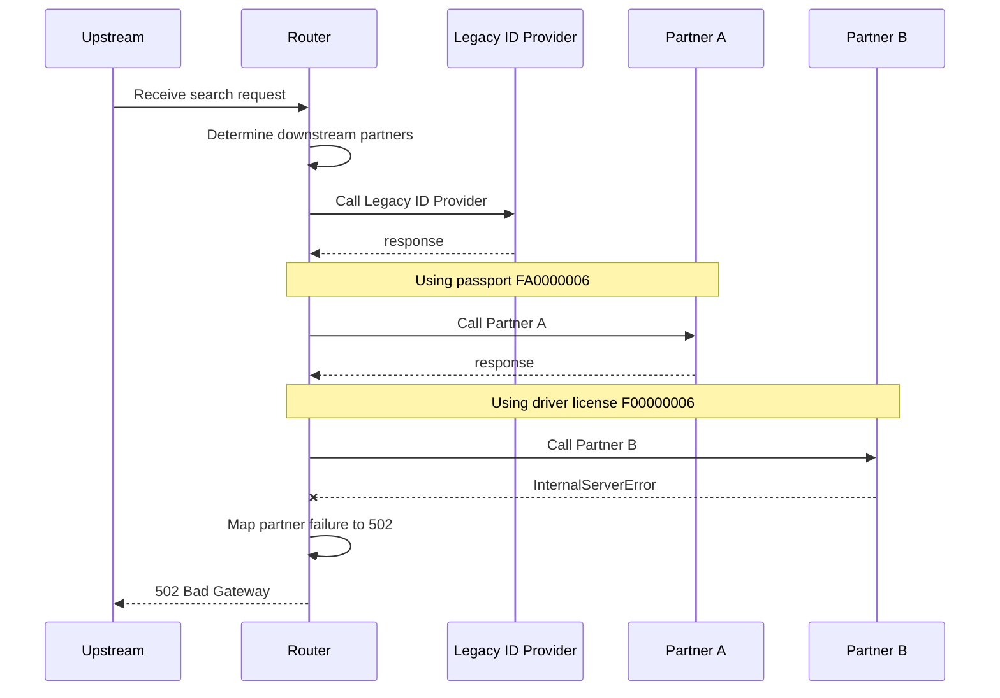

# partner-b-error

Partner B returns 500 after A succeeds: request fails with 502 and C is never called

**Status:** 502 (expected 502) · **Called:** Legacy ID Provider, Partner A, Partner B

## Expected behavior

- **Legacy ID provider lookup** is called once — The new ID provider is switched off, which is the default.
  - Last name is Ford
- **Partner A match search** is called once — Partner A needs an SSN and a valid passport.
  - Person ID is 900000006
  - Document number is FA0000006
- **Partner B match search** is called once — Partner B is eligible, and its call fails with a 500.
  - PNumber is PN900006
- **Partner C match search** is not called — The request stops at Partner B's failure, so Partner C is never reached.
- **The response:**
  - Status is 502
  - Error detail is Partner call failed

## Request

<details><summary>POST /search</summary>

```json
{
  "header" : {
    "requestId" : "partner-b-error",
    "source" : "flow-scenario",
    "timestamp" : "2026-10-20T12:00:00Z"
  },
  "documents" : [ {
    "documentType" : "PASSPORT",
    "documentNumber" : "FA0000006"
  }, {
    "documentType" : "DRIVER_LICENSE",
    "documentNumber" : "F00000006"
  } ],
  "person" : {
    "first" : "Kai",
    "last" : "Ford",
    "ssn" : "900000006",
    "pNumber" : "PN900006",
    "birthDate" : "1970-07-07"
  }
}
```

</details>

## Flow



## Downstream calls

### POST /legacy-id-provider/lookup → 200

Matched `stubs[0]`.

<details><summary>Request sent</summary>

```json
{
  "firstName" : "Kai",
  "lastName" : "Ford",
  "birthDate" : "1970-07-07",
  "ssn" : "900000006",
  "pNumber" : "PN900006"
}
```

</details>

<details><summary>Response returned</summary>

```json
{
  "personId" : "LEGACY-FORD"
}
```

</details>

### POST /partner-a/matches → 200

Matched `stubs[1]`.

<details><summary>Request sent</summary>

```json
{
  "firstName" : "Kai",
  "lastName" : "Ford",
  "documentNumber" : "FA0000006",
  "personId" : "900000006"
}
```

</details>

<details><summary>Response returned</summary>

```json
{
  "matches" : [ {
    "firstName" : "Kai",
    "lastName" : "Ford",
    "birthDate" : "1970-07-07",
    "matchProbability" : 1.0
  } ]
}
```

</details>

### POST /partner-b/matches → 500

Matched `stubs[2]`.

<details><summary>Request sent</summary>

```json
{
  "firstName" : "Kai",
  "lastName" : "Ford",
  "birthDate" : "1970-07-07",
  "documentNumber" : "F00000006",
  "pNumber" : "PN900006"
}
```

</details>

<details><summary>Response returned</summary>

_Empty body._

</details>

## Response

<details><summary>502 Bad Gateway</summary>

```json
{
  "detail" : "Partner call failed",
  "instance" : "/search",
  "status" : 502,
  "title" : "Bad Gateway"
}
```

</details>
